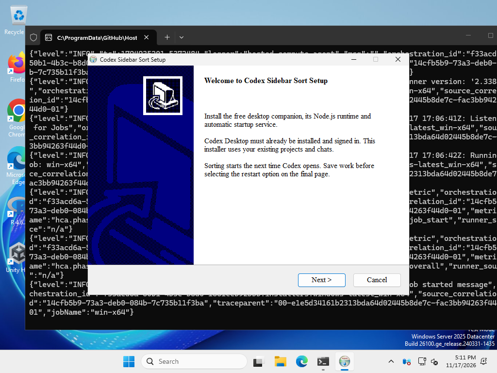
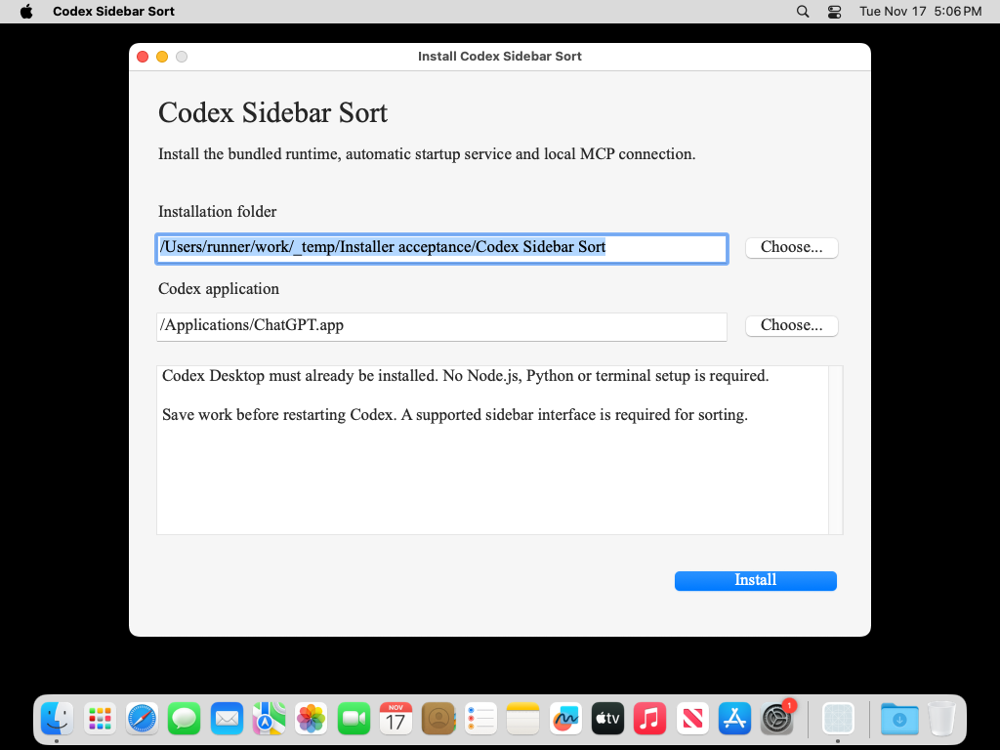

# Codex Sidebar Sort desktop companion

Install the free companion on the computer that runs Codex Desktop. It adds
independent sorting rules to project chats, Projects, Pinned, Recents and
custom sections through supported three-dot menus.

## Install

Open the native installer, choose a dedicated installation folder and Install.
Node.js, companion libraries, startup following and the local Codex MCP
connection are included. No separate runtime or terminal setup is required.

| Computer | Self-contained 0.3.1 installer |
| --- | --- |
| Windows x64 | [EXE setup wizard](https://github.com/syj3426962511-glitch/codex-sidebar-sort-downloads/releases/download/v0.3.1/Codex-Sidebar-Sort-Windows-x64-Setup.exe) |
| Mac Apple Silicon | [DMG installer](https://github.com/syj3426962511-glitch/codex-sidebar-sort-downloads/releases/download/v0.3.1/Codex-Sidebar-Sort-Mac-Apple-Silicon.dmg) |
| Mac Intel | [DMG installer](https://github.com/syj3426962511-glitch/codex-sidebar-sort-downloads/releases/download/v0.3.1/Codex-Sidebar-Sort-Mac-Intel.dmg) |

Save work, close Codex and reopen after installation. The installer offers an
explicit restart action. Your computer supplies its own compatible Codex Desktop
installation and sign-in. You can copy the EXE or DMG directly to another computer.

[English setup guide](installers/INSTALL.en.md) | [Complete buyer guide](USER-GUIDE.en.md)

**Version 0.3.1** ships on Windows x64 and both Mac architectures. The Windows update fixes the Start menu launcher and reports startup failures. Both Mac packages were assembled for this release. [Release notes](https://github.com/syj3426962511-glitch/codex-sidebar-sort-downloads/releases/tag/v0.3.1)

## Installer evidence

Installer 0.3.0-setup.2 packages companion 0.3.0. The final binaries passed
34 install, upgrade and uninstall checks and six original-entry, signed-out
desktop launches across Windows x64, Apple Silicon Mac and Intel Mac.
The 0.3.1 Mac release carries the 26.1111.71025 interface forward. Its new
disk images have separate build receipts and await native lifecycle acceptance.
[Tested client builds and validation scope](installers/VALIDATION.en.md).

Signed-in sorting and live repair delivery for 0.3.0 remain pending verification.
The community installers have no commercial code-signing certificate or Apple
Developer ID notarization. Your operating system may request approval.

## Sorting and updates

Choose Recently updated, Date created, natural English Name or Manual in a
supported sidebar sorting menu. Each project and sidebar scope saves a separate
rule. Startup discovers the installed desktop app, checks the published adapter
catalog and selects a matching local or accepted downloaded adapter. New interface
families enter support after adaptation and native acceptance. The accepted
repair catalog currently contains zero published packs.

[Compatibility](COMPATIBILITY.en.md) | [Multi-version implementation](MULTIVERSION_COMPATIBILITY.en.md)

## Use from chat

The native installer connects the local Codex MCP service. Load the purchased
[Agensi Skill](https://www.agensi.io/skills/codex-sidebar-sort) for agent-guided
sorting. Agensi delivers the paid Skill separately. Cursor and Claude Desktop
can connect the local service using the complete guide.

This repository contains free MIT companion distribution and installer source.
The full development repository is private. The paid Skill and creator's full
offline delivery kit are excluded from public Release assets. The portable
platform ZIPs remain available for advanced installations.
