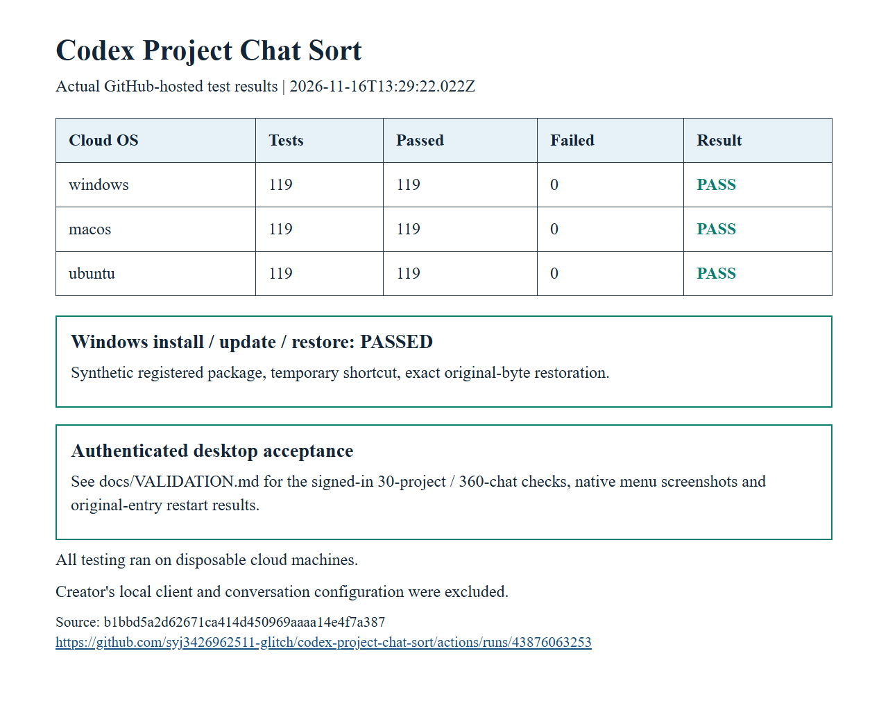
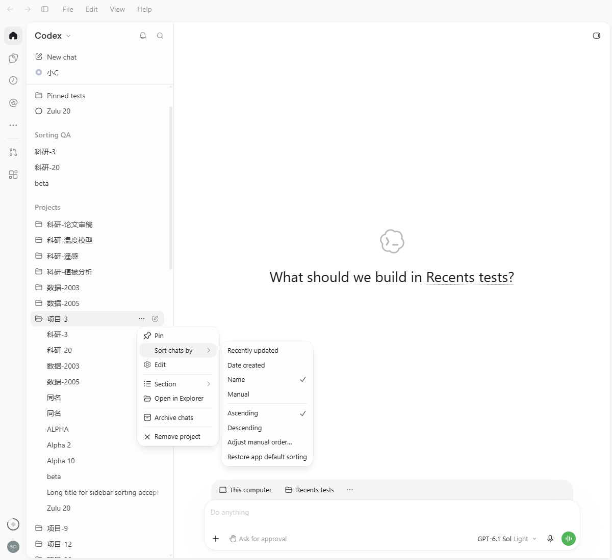
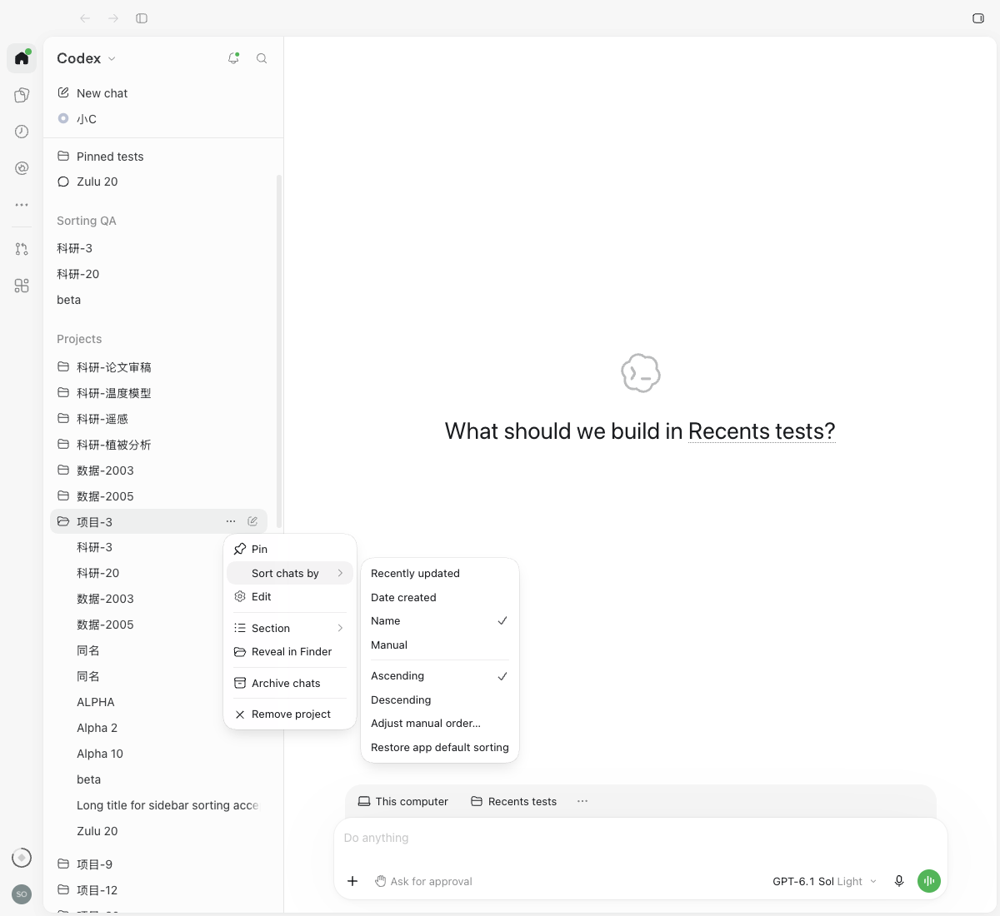

# Validation

## Signed-in desktop sorting

Windows 26.1111.2228.0 and macOS 26.1111.21308 were checked on independent cloud desktops with 30 real native projects and 360 test chats each. All five scope types passed recently-updated, creation-date, natural-name and manual ordering, automatic ascending and descending, reset, live renaming and production manual-editor saving.

Two original-entry starts retained project identity, every chat ID, valid native membership and saved rules. The published 0.2.0-rc.1 ZIPs were then installed and tested through two additional original-entry starts. Authenticated Mac UI evidence uses Apple Silicon. Intel Mac packaging and installation checks passed.

## Marketplace delivery

Four real Agensi MCP get_skill reads through an authorized creator account matched SKILL.md, the complete English guide, the MCP reference and LICENSE during the earlier free launch. The test connection was disconnected afterwards. The creator has since enabled paid sales. The public listing displays the creator-selected price. A separate paid checkout remains untested.

## Compatibility update

Release 0.2.0-rc.2 adds verified-content discovery after renderer resource renames or relocation. Its automated, packaging and official-client smoke checks are recorded in the release receipt.

Full operating-system reboot, simultaneous native windows, custom desktop-data-home propagation, existing signed-in legacy migration and changed renderer interfaces retain dedicated acceptance. Functional tests run on independent cloud computers.

Windows, macOS and Linux each passed 119 automated tests for rc.2. The four-file Skill passed 22 tests per OS. All three platform packages passed delivered installation fixtures. Official fresh-profile Windows and Mac clients passed launch, full close/reopen, injection and fixture-preference retention. Official resources renamed into a temporary cloud archive passed content discovery through the normal diagnostic entry point.

[rc.2 receipt](receipts/release-0.2.0-rc.2.json) · [Earlier signed-in release receipt](receipts/release-0.2.0-rc.1.json)

